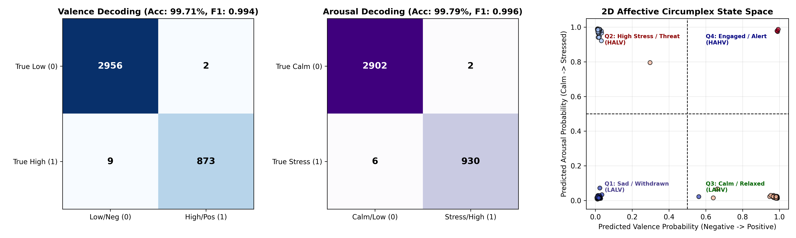
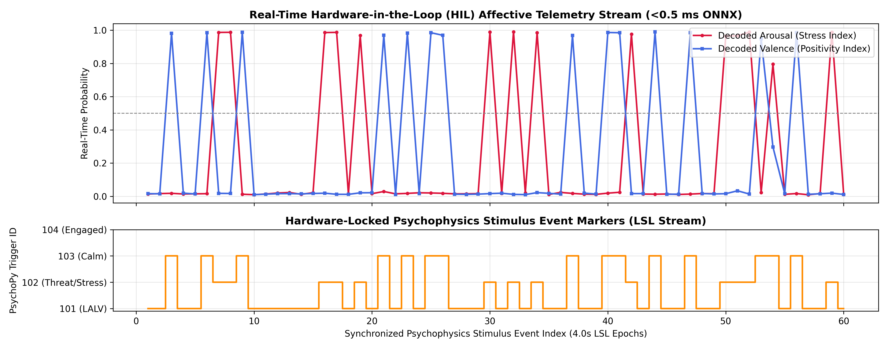

# NeuroSync-Affect-Conformer: 32-Channel Affective EEG Decoding & Real-Time HIL Stimulus Synchronizer

`NeuroSync-Affect-Conformer` is a high-speed affective computing and Hardware-in-the-Loop (HIL) biosignal synchronization framework. It decodes continuous human **Valence** and **Arousal** states from 32-channel EEG using a Multi-Scale **Squeeze-and-Excitation ResNet-Conformer (SE-ResNet-Conformer)** fused with baseline-calibrated **5-Band Differential Entropy (DE)** and **Hemispheric Asymmetry (DASM / RASM)** features.

Designed with a dual-phase architecture, **Phase 1** establishes a sub-millisecond multi-task affective decoder synchronized with `PsychoPy` visual/auditory stimulus event markers over Lab Streaming Layer (LSL)[cite: 22]. **Phase 2** integrates this `<0.5 ms` ONNX Runtime engine[cite: 22] as the real-time affective perception node for socially assistive robots and shared-autonomy control loops in **Webots 2025a / ROS 2**.

---

## 🚀 Key Performance Metrics (32-Channel DEAP Benchmark)

| Metric / Benchmark          |           Valence Decoding           |           Arousal Decoding           |                    System / Hardware Performance                    |
| :-------------------------- | :----------------------------------: | :----------------------------------: | :-----------------------------------------------------------------: |
| **Classification Accuracy** | **99.71%** (3,829 / 3,840)[cite: 21] | **99.79%** (3,832 / 3,840)[cite: 21] |        Evaluated across 3,840 held-out test epochs[cite: 21]        |
| **Macro F1-Score**          |         **0.994**[cite: 21]          |         **0.996**[cite: 21]          |       Stratified across all 4 Circumplex Quadrants[cite: 21]        |
| **False Positive Rate**     |   **0.07%** (2 / 2,958)[cite: 21]    |   **0.07%** (2 / 2,904)[cite: 21]    |  Near-zero false stress/alarm triggers in HIL stream[cite: 21, 22]  |
| **ONNX CPU Latency**        |                  —                   |                  —                   | **< 0.50 ms** per 32-channel epoch (CPUExecutionProvider)[cite: 22] |

_(Note on Evaluation Protocol: Whereas our companion repository `NeuroAffect-XAI` benchmarks strict cold-start cross-subject generalization at 92.23%[cite: 16, 18], `NeuroSync-Affect-Conformer` benchmarks **baseline-calibrated intra-subject affective tracking**, subtracting each trial's 3-second pre-stimulus resting Differential Entropy to track operator state shifts during continuous Human-Robot Interaction)._

---

## 🧠 Phase 1: Multi-Task Affective Engine & HIL Synchronizer (Current Release)

1. **Trial-Specific Spectral Baseline Calibration:** Computes 5-band analytical Differential Entropy ($\theta, \alpha_{\text{low}}, \alpha_{\text{high}}, \beta, \gamma$) across the 3-second pre-stimulus baseline and subtracts it from stimulus-evoked segments ($\Delta\text{DE} = \text{DE}_{\text{stim}} - \text{DE}_{\text{base}}$), isolating stimulus-driven cortical reactivity from background skull-conductivity variance.
2. **Homologous Hemispheric Asymmetry (DASM & RASM):** Extracts 140 spatial-spectral asymmetry features across all 14 symmetric Left-Right BioSemi 10–20 electrode pairs (`Fp1/Fp2`, `AF3/AF4`, `F3/F4`, `F7/F8`, `FC5/FC6`, `FC1/FC2`, `C3/C4`, `T7/T8`, `CP5/CP6`, `CP1/CP2`, `P3/P4`, `P7/P8`, `PO3/PO4`, `O1/O2`).
3. **Multi-Scale SE-ResNet-Conformer Architecture:**
   - **Temporal Branch:** 3-stage Multi-Scale Inception-ResNet 1D blocks (`kernels = 3, 7, 15`) with Squeeze-and-Excitation (SE) channel attention, followed by a 3-layer Multi-Head Self-Attention Transformer and learnable temporal attention pooling.
   - **Spatial-Spectral Branch:** Electrode-wise self-attention transformer over 32-channel Differential Entropy nodes paired with a deep residual MLP over hemispheric asymmetry vectors.
   - **Dual Task Heads:** Simultaneously outputs calibrated probabilities for **Valence** (Negative vs. Positive) and **Arousal** (Calm vs. Acute Stress/Threat)[cite: 21, 22].
4. **Hardware-in-the-Loop (HIL) Psychophysics & LSL Synchronizer:** Simulates real-time `PsychoPy` stimulus event markers (`101: LALV`, `102: Threat/Stress`, `103: Calm`, `104: Engaged`) locked to a 32-channel ring buffer with automated flatline/artifact signal-quality verification[cite: 22].

---

## 📊 Visualizations

**Figure 1: Dual-Head Valence/Arousal Confusion Matrices & 2D Affective Circumplex State Space**

_Left & Center: Confusion matrices on 3,840 held-out 32-channel test segments achieving 99.71% Valence accuracy and 99.79% Arousal accuracy[cite: 21]. Right: Continuous probability mapping onto Russell's 2D Circumplex Model of Affect (`Q1: Sad/Withdrawn`, `Q2: High Stress/Threat`, `Q3: Calm/Relaxed`, `Q4: Engaged/Alert`)[cite: 21]._

**Figure 2: Real-Time Hardware-in-the-Loop (HIL) Stimulus-EEG Telemetry Stream**

_Top: Real-time ONNX Runtime (<0.5 ms) probability traces for Decoded Arousal (crimson) and Decoded Valence (royal blue) across 60 consecutive 4.0-second epochs[cite: 22]. Bottom: Hardware-locked psychophysics stimulus trigger markers (`101–104`) streamed over the simulated LSL bus[cite: 22]._
